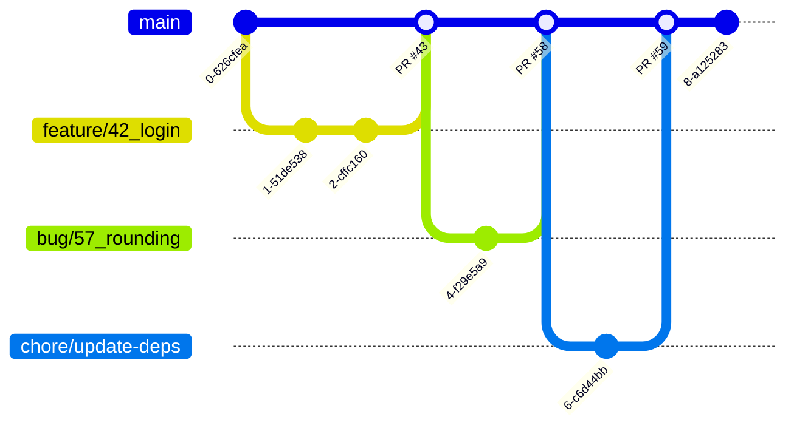

# Source Control

## Table of Contents

1. [General guidelines](#general-guidelines)
2. [Merging strategy](#merging-strategy)
3. [Branch naming](#branch-naming)
4. [Commit messages](#commit-messages)

## General guidelines

- We adopt Trunk Based Development. More info: [link](https://trunkbaseddevelopment.com/).
- Our default branch is the 'trunk', named `main`.
- We merge into `main` only through PRs with green CI. `main` is protected on `origin`; where the plan can't protect it, a `no-commit-to-branch` pre-commit hook blocks local commits to it.
- We open short-lived branches from `main` (one person, a couple of days at most) and merge them back through PR review and CI.
- We don't use release branches (unless strictly necessary) and we release from `main`.

### Diagram

Every branch starts from the tip of `main` and lands back on it as one squashed commit; nobody works on `main` directly. Based on [trunkbaseddevelopment.com](https://trunkbaseddevelopment.com/).

## Merging strategy

- We squash merge PRs: each PR lands on `main` as one commit, keeping history linear.
- The squash commit subject is the PR title, so PR titles follow the [commit message](#commit-messages) rules (GitHub appends `(#<PR number>)`).
- Commits inside the PR branch are not preserved; no need to clean them up before merging.

## Branch naming

- We follow this template: `<type>/<title>`, or `<type>/<issue number>_<title>` when the work has a GitHub issue; reference it in the PR body (e.g. `Closes #42`) so it is linked and auto-closed.
  - The `<type>` can be one of `feature|bug|hotfix|chore|experiment`.
    - `feature`: New feature or enhancement.
    - `bug`: Bug fix.
    - `hotfix`: Critical bug fix that needs to be fixed ASAP and could not follow the traditional process.
    - `chore`: Changes that don't fit in any of the above categories.
    - `experiment`: Experiments.

### Examples

- `feature/42_add-new-feature` (GitHub issue #42)
- `chore/update-readme`
- `bug/57_fix-bug` (GitHub issue #57)
- `hotfix/63_fix-critical-bug` (GitHub issue #63)
- `experiment/do-not-deploy`

## Commit messages

- The essential parts of a commit message are:
  - subject line: a short description of the commit, maximum 50 characters long.
  - body (optional): a longer description of the commit, wrapped at 72 characters, separated from the subject line by a blank line.
- The subject line is written in the imperative mood, in English.
- We use [Conventional Commits](https://www.conventionalcommits.org/en/v1.0.0/). Some examples:
  - `feat: add new feature`
  - `fix: fix user creation critical bug`
  - `chore: update deps`
  - `docs: update readme`
